# 동명동·충장로 관광지 (뚜벅이 여행 · 먹거리·카페·숙소 제외)

> 조사일: 2026-11-12 · [번호]는 아래 출처 목록 번호
> 운영시간·휴일·전시 기간·가격은 자주 바뀌니까 가기 전에 공식 사이트에서 한 번 더 확인하기.
> 걸어서 몇 분 걸리는지는 직접 재 보지 않았어. 지도 앱으로 꼭 확인하기.

## 한눈에 보기
- 모든 곳이 **국립아시아문화전당(ACC)·5·18민주광장**을 중심으로 모여 있어. ACC가 동명동이랑 붙어 있고, 금남로·충장로가 바로 앞이라 걸어서 돌기 좋아 [1][2][5][6]
- ⚠️ **월요일 피하기**: 실내 전시는 대부분 월요일에 쉬어 (아래 쉬는 날 정리 참고)

## 쉬는 날 정리 (월요일만 쉬는 거 아님!)
| 장소 | 월요일 | 그 밖에 쉬는 날 | 출처 |
|---|---|---|---|
| ACC 실내 전시 | ❌ 휴관 | 1월 1일 | [22] |
| ACC 야외(광장·하늘마당) | 공식 안내에 따로 없음 | 06:00~22:00만 열림 | [22] |
| 옛 전남도청 | ❌ 휴관 (월요일이 공휴일이면 **화요일**에 쉼) | — | [29] |
| 5·18민주화운동기록관 | ❌ 휴관 | 1월 1일, 설, 추석 | [32] |
| 광주미디어아트플랫폼(G.MAP) | ❌ 휴관 | 1월 1일, 설·추석 당일 | [33] |
| **전일빌딩245** | ✅ **열림** | 1월 1일, 설, 추석 | [3] |
| 5·18민주광장, 금남로, 충장로, 예술의 거리 | ✅ 열림 | 없음 (늘 열림) | [33] |
| 광주극장 | 확인 못 함 | 확인 못 함 | — |

👉 **월요일에 가면 볼 수 있는 실내 전시는 전일빌딩245 정도**라서, 월요일은 피하는 게 좋아.

## 꼭 가볼 곳 (추천 순)
| 순위 | 장소 | 왜 가볼 만한지 | 시간·요금 | 출처 |
|---|---|---|---|---|
| 1 | **옛 전남도청** (ACC 안) | 1980년 5월 시민군이 마지막까지 버틴 곳. **2026년 5월 18일 복원을 마치고 정식 개관**했어. 개관 한 달 만에 14만 명이 다녀감. 소설 『소년이 온다』의 주요 무대이기도 해 | 10:00~18:00 (17:30 입장 마감) / 무료 / 월요일 휴관. ⚠️ 2026년 말 이후 운영할 기관이 아직 정해지지 않았다는 보도가 있어 | [10][11][12][29] |
| 2 | **국립아시아문화전당(ACC)** | 2025~2026 한국관광100선. 전시·공연이 1년 내내 열리고, 하늘마당과 지상정원은 무료로 쉬어 가기 좋아 | 실내 10:00~18:00 (수·토 일부 시설은 20:00까지) / 야외 06:00~22:00 / 월요일·1월 1일 휴관 | [1] |
| 3 | **5·18민주광장** | 5·18 때 분수대를 연단 삼아 집회를 열던 곳. 한국 민주주의를 상징하는 장소 | 24시간 / 무료 | [2] |
| 4 | **전일빌딩245** | 금남로1가 1번지. 1980년 헬기 사격으로 생긴 **총탄 자국 245개**가 남아 있어서 이름이 전일빌딩245 | 09:00~22:00 (겨울 21:00까지), 전시 공간 10:00~19:00 / 무료 / 1월 1일·설·추석 휴관 | [3] |
| 5 | **5·18민주화운동기록관** | 유네스코 세계기록유산인 5·18 기록물을 보관하는 곳. 옛 가톨릭센터 건물에 있어. 정기 해설 40~50분 | 09:00~18:00 (17:40 입장 마감) / 상설전시 무료 / 월요일 휴관 | [4] |
| 6 | **광주극장** (충장로) | 1935년 문을 연 단관극장(스크린이 하나뿐인 극장). 지금도 영화를 틀고, 간판을 손으로 그려. 2026년 10월 국가등록문화유산 등록 예고 | 상영 시간표는 따로 확인 필요 | [13][14] |
| 7 | **충장로** | 1~3가는 패션 거리, 4~5가는 한복집이 모인 **주단거리**. 이름은 김덕령 장군의 시호 '충장'에서 따옴 | 상시 개방 | [6] |
| 8 | **예술의 거리** (궁동) | 갤러리·화방·표구점·골동품점·고서점이 모인 거리. 서울 인사동 같은 느낌. 토요일에는 차 없는 거리가 되고 골동품 장터가 열려 | 상시 개방 | [7] |
| 9 | **광주미디어아트플랫폼(G.MAP)** + **희경루** | 광주천 건너 광주공원 쪽. G.MAP은 미디어아트 전시관, 희경루는 2023년에 다시 지은 조선시대 누각. 둘이 붙어 있어서 같이 보기 좋아 | G.MAP 10:00~18:00, 무료, 월요일 휴관 (금남로4가역 2번 출구에서 698m) / 희경루 09:00~20:00, 무료 | [9][15] |

## 지나가면서 보기 좋은 곳
| 장소 | 특징 | 출처 |
|---|---|---|
| 금남로 | 3·1 만세운동이 모인 곳이자 5·18의 중심 거리. ACC 앞 큰길 | [3][5] |
| 전라남도 도청 회의실 | 1930년 한국인 건축가 김순하가 설계한 붉은 벽돌 건물. 모서리와 창을 둥글게 만든 당시로선 새로운 디자인 | [16] |
| 광주YMCA (5·18사적) | 항쟁 지도부가 집회를 열고 시민군이 총기 훈련을 한 곳 · 금남로 246 | [17] |
| 광주YWCA 옛터 (5·18사적) | 『민주시민회보』를 만들던 곳이자 마지막 항전 장소 중 하나 · 중앙로196번길 | [18] |
| 궁동예술극장 | 지방자치단체가 처음으로 연 연극 전용 소극장 · 예술의 거리 안 | [19] |
| 충장로 홍콩골목 | 네온사인 골목. 밤에 사진 찍기 좋은데, 가게가 홍콩식 샤브샤브·포차·바라서 먹거리 쪽에 가까워 | [8] |

## 추천 걷기 순서 (Claude가 짠 동선)
> ⚠️ 위치만 보고 짠 순서야. 걷는 시간은 지도 앱으로 확인하기.

**동명동 쪽에서 출발 → 광주천에서 마무리**
1. ACC (하늘마당·지상정원) → 2. 옛 전남도청 → 3. 5·18민주광장 → 4. 전일빌딩245 (금남로 건너편) → 5. 금남로 따라 5·18민주화운동기록관 → 6. 기록관 뒤쪽 예술의 거리 → 7. 충장로 걷다가 광주극장 → 8. 체력 남으면 광주천 건너 G.MAP·희경루

- **반나절**이면 1~5번까지만 (5·18 역사 코스)
- **하루**면 8번까지 다 (역사 + 예술 + 원도심)

---

## 장소별 꼭 볼 것

### 1. 국립아시아문화전당(ACC)
**크기:** 건물 5개(문화정보원·문화창조원·예술극장·어린이문화원·민주평화교류원)가 땅 아래로 들어가 있는 구조야. 다 보면 하루도 모자라 [22][23]

#### ⭐ 꼭 할 것
| 할 것 | 내용 | 시간·요금 | 출처 |
|---|---|---|---|
| **ACC 한바퀴 투어 (해설사 동행)** | 처음 가면 이게 제일 좋아. 방문자센터 → 아시아문화광장 → 민주평화교류원(옛 전남도청) → 예술극장 → 문화창조원 → 문화정보원을 50분 동안 해설 들으면서 한 바퀴 돌아. 넓어서 길 잃기 쉬운데 이걸로 한 번에 정리됨 | **무료** · 화~일 10:30 / 13:00 / 14:30 · 회당 30명 · 온라인 예약은 2일 전 17시까지, 남은 자리는 현장 신청 가능 · 12~2월은 실내 동선으로 짧게 운영 | [24] |
| 건축투어 / 공공미술투어 | 건물 설계나 곳곳에 있는 공공미술 작품을 깊이 있게 해설 | 무료 · 16:00 (화·목·토 건축, 수·금·일 공공미술) | [24] |
| **미디어파사드** | 아시아문화광장 건물 벽(미디어월)에 작가 15명의 영상 작품을 틀어 줘. 지나가다 멈춰서 보기 좋아 | **무료 · 매일 16:00~17:00** · 12월 31일까지 | [25] |

#### 🖼️ 지금 하는 전시 (2026년 11월 기준)
| 전시 | 한 줄 설명 | 기간 | 요금 | 출처 |
|---|---|---|---|---|
| **인상파, 찬란한 순간들** | 모네·르누아르·반 고흐·세잔 등 인상파 화가 11명의 **진짜 원화**. 예루살렘 이스라엘 박물관 소장품. 이번 시즌 제일 큰 전시 | ~2027.2.21 | 성인 13,000원 / 청소년·어린이 10,000원 | [26] |
| **식객: 맛의 뒤편** | 허영만 만화 『식객』 속 남도 음식 이야기를 공간으로 꾸민 전시. 흑백 만화 컷을 큰 벽으로 펼친 입구가 포토존 느낌 | ~12.13 | 10,000원 | [27] |
| 미틸라 회화 | 인도·네팔 여성들이 집 벽에 그려 온 전통 그림. **국내 첫 전시** | ~2027.2.28 | 무료 | [28] |
| 김영은 《미래의 청취자들에게》 | 공간음향으로 "듣는" 전시. 소리가 방 안을 돌아다녀 | ~2027.2.14 | 무료 | [28] |
| 광주비엔날레 대만 파빌리온 | 비엔날레 연계 전시 | **~11.15 (곧 끝남)** | 확인 못 함 | [20][28] |
| 아시아문화박물관 상설전 | 「길 위의 노마드: 중앙아시아」, 「몬순으로 열린 세계: 동남아시아 항구도시」 등 | 상설 | 무료 | [28] |

💡 **할인 팁:** 매달 **둘째·넷째 수요일**(문화가 있는 날)엔 문화창조원·어린이문화원 유료 전시가 50% 할인. 일부 전시는 할인 안 됨 [22]
💡 **수·토요일**엔 문화정보원·문화창조원이 **저녁 8시**까지 열어 [22]

### 2. 옛 전남도청 (ACC 민주평화교류원)
2026년 5월 18일 복원을 마치고 정식 개관한 곳 [22][29]

| 항목 | 내용 | 출처 |
|---|---|---|
| 시간·요금 | 10:00~18:00 (17:30 입장 마감) · **무료** | [29] |
| **꼭 볼 곳 6곳** | 도청 본관 · 도청 별관 · 도청 회의실 · 도경찰국 본관 · 도경찰국 민원실 · **상무관** (모두 상설전시) | [29] |
| ⭐ **전시해설(도슨트)** | 약 **1시간 30분** 동안 해설사와 함께 도청 입구부터 상무관까지 돌아. 관람 **전날 17시까지** 예약, 회차당 20명 · 예약 안 하면 자유 관람도 가능 | [29][30] |
| 시작 위치 | 도청 별관 1층 **방문자센터** (안내 지도, 물품보관함 있음) | [30] |
| ⭐ **스탬프투어** | 「한 장의 엽서에 담은 오월」: 도청 안 스탬프 4개를 찾아 엽서를 완성하는 상설 프로그램 | [29] |
| 🆕 **특별전** | 「RECORDS LIVE ON 기록은 계속된다 - 푸른 눈의 목격자, 힌츠페터가 남긴 유산」 · 1980년 광주를 취재한 독일 기자 힌츠페터 10주기 전시 · **2026.11.5 ~ 2027.3.28** · 도경찰국 민원실 | [29] |

### 3. 전일빌딩245
| 층 | 볼 것 | 출처 |
|---|---|---|
| **10층** ⭐ | **헬기 사격 탄흔 245개를 그대로 보존한 공간.** 바닥·기둥·천장에 총탄 자국이 남아 있어. 들어가자마자 이혜경 작가의 작품 「민주의 탄환」이 있다는 후기가 있어 | [31] |
| 9층 | 5·18 전시관 (19800518 기념공간) | [31] |
| **옥상 '전일마루'** ⭐ | 광주 시내가 한눈에 보이는 무료 전망대. 밤 10시까지 열어서 야경 보기 좋아 | [31] |
| **2층 '오매나하우스'** 🛍️ | 광주 공식 관광기념품 가게 (아래 기념품 참고) | [34] |

- 기념공간 10:00~19:00 · **무료** [3]
- **정기 해설: 하루 5번** (11:00, 13:00, 14:30, 16:00, 17:30). 그 밖의 시간에도 상주 해설사에게 물어보면 설명해 줘 [31]

### 4. 5·18민주화운동기록관
- 옛 광주가톨릭센터 건물. 지하 1층~지상 7층 [32]
- **층별 주제:** 1층 「항쟁」 · 2층 「기록」 · 3층 「유산」 + 기획전시실 [32]
- **정기 해설 (40~50분):** 월~토 10:00, 11:00, 14:00, 15:00, 16:30 / 일 10:00, 11:00, 14:30, 16:00 [33]
  - ⚠️ 해설 시간표에 월요일이 있는데 기록관은 월요일 휴관이라서 서로 안 맞아. 가기 전에 전화로 확인하기 (062-613-8299)
- 상설전시 **무료** [33]

### 5. 광주극장 (충장로)
- **1935년** 문을 연 **국내 유일의 단관극장**(스크린이 하나뿐인 극장). 2026년 10월 국가등록문화유산 등록 예고 [13]
- ⭐ **손간판 보기:** 지금도 극장 미술실에서 영화 간판을 **손으로 그려**. 극장 앞에 걸린 손그림 간판이 핵심 볼거리야 [35]
- ⭐ **개관 91주년 영화제:** 2026.10.16 ~ **11.15**. 시민 15명이 '영화간판학교'에서 직접 그린 손간판도 걸려 있어 [35]
- 영화를 안 보더라도 극장 앞 간판은 꼭 보고 가기

## 이번 주에만 볼 수 있는 것 (11월 15일까지)
- ACC 안 광주비엔날레 **대만 파빌리온** 전시 [20]
- 제16회 광주비엔날레 (본전시장은 북구 비엔날레전시관이라 이 동선 밖) [21]
- 광주극장 개관 91주년 영화제 [35]

---

## 🛍️ 기념품: 이거 사면 돼
> 사진은 각 공식 판매처 사이트에서 가져왔어 (ACC 들락 온라인숍, 오매광주). 가격은 2026-11-12 사이트 기준.

### 🅰️ ACC 문화상품점 「들락 DLAC」
- 위치: **문화정보원 지하 3층 (아시아문화광장)** · 10:00~18:00 (수·토 20:00까지) · 휴관일엔 쉼 [36]
- 들락은 ACC 기념품 브랜드고, 아시아 작가들과 같이 만든 생활용품을 팔아 [36]

| 추천 | 사진 | 가격 | 왜 추천? | 출처 |
|---|---|---|---|---|
| **들락 수건** | 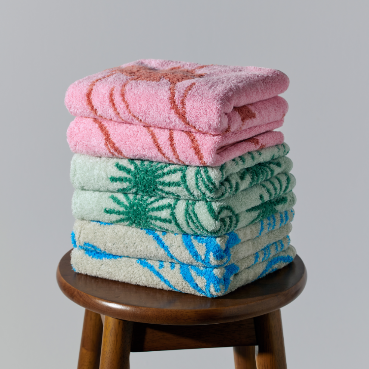 | 9,000원 | 온라인숍 **인기 검색어**에 있고, 가격 부담이 적어서 선물용으로 좋아 | [37] |
| **들락 WAA 니트 블랭킷** | 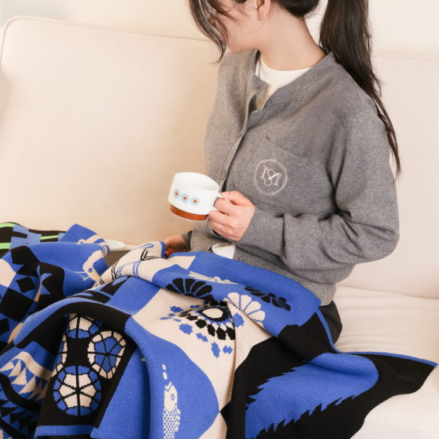 | 44,000원 | 인기 검색어에 있는 대표 상품, 겨울이라 딱 | [37] |
| **[한정판] '빛의 숲' 테이블 조명** | 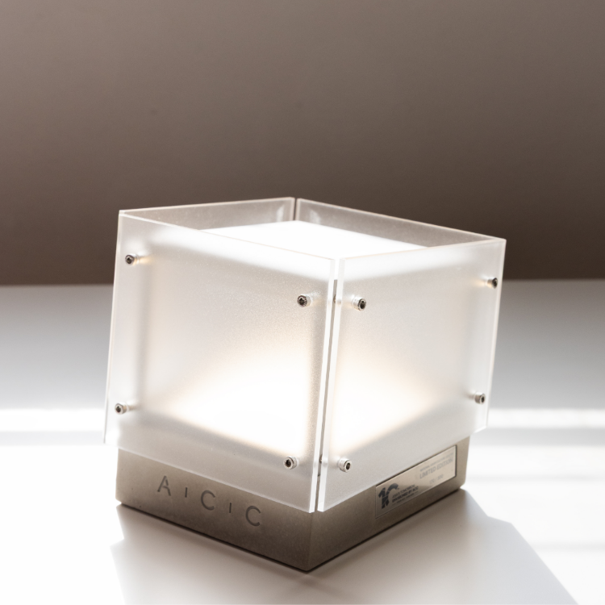 | 135,000원 → 94,500원 | **ACC 개관 10주년 한정판**. 메인 화면 상품 중 리뷰가 가장 많음(12개) | [37] |
| 하늬 백 (저스트 프로젝트) | 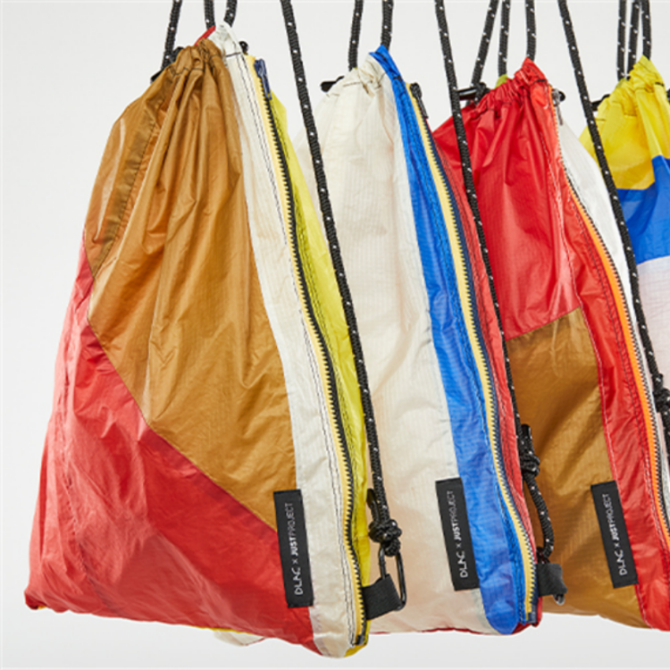 | 32,000원 | 인기 검색어에 있는 가방 | [37] |
| ACC 코스터 | 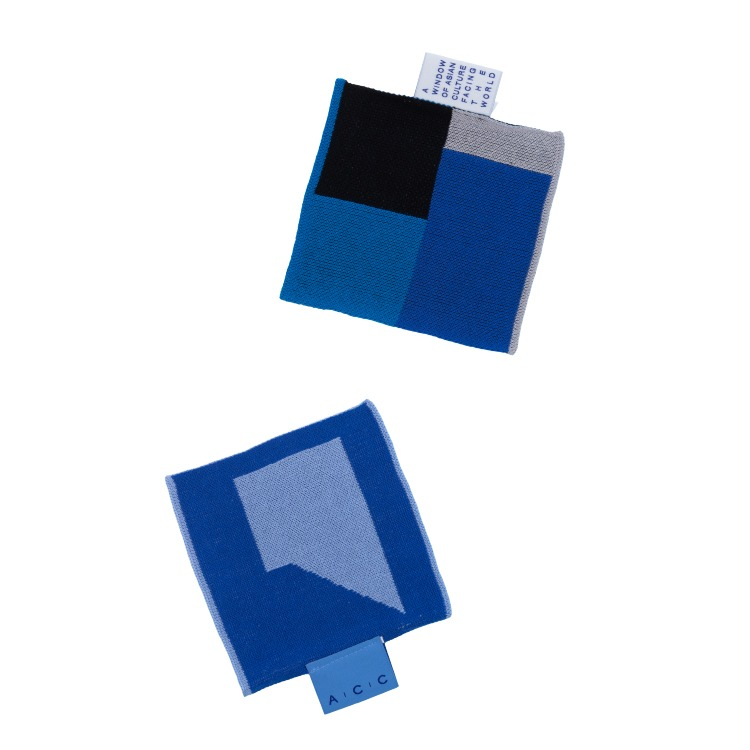 | 10,000원 | ACC 로고가 들어간 가볍고 저렴한 기념품 | [37] |
| 시간을 담은 아시아의 향 티 세트 | 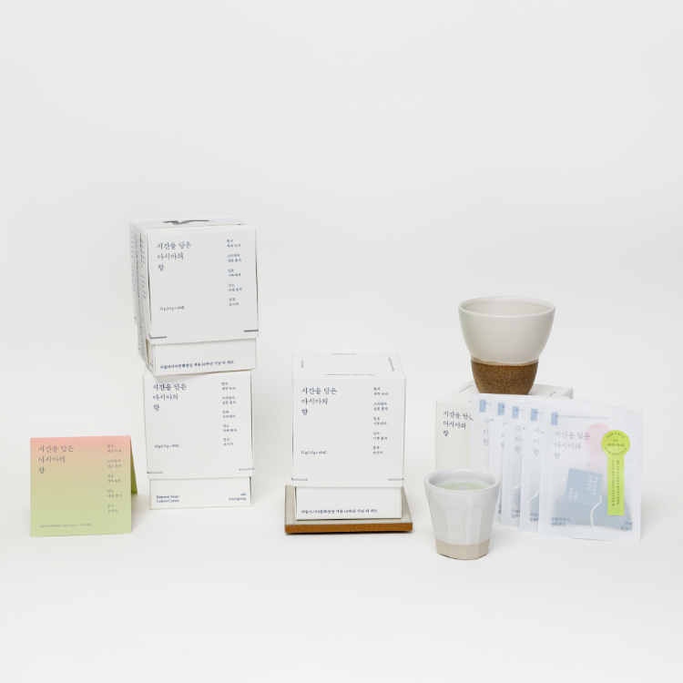 | 17,500원 | 리뷰 9개로 인기 많은 편 | [37] |

### 🅱️ 광주 공식 관광기념품 「오매나하우스」(남도관광센터)
- 위치: **전일빌딩245 2층** (금남로 245) · 062-223-3631 → 동선 중간이라 들르기 편해 [34]
- 동명동에도 위탁판매점 **파파샵**(동구 장동로 2)이 있어 [34]

| 추천 | 사진 | 가격 | 왜 추천? | 출처 |
|---|---|---|---|---|
| **명소 마그넷** | 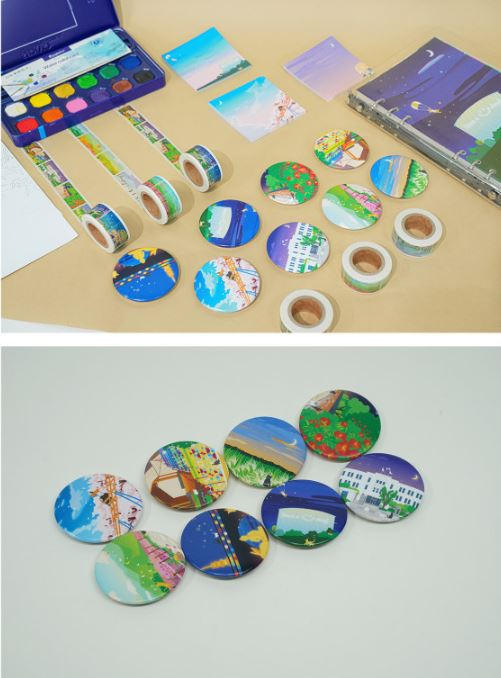 | 대 5,000원 / 미니세트 9,000원 | 광주 명소를 그린 그림이라 여행 기념으로 딱 | [34] |
| **명소 엽서 30종** | 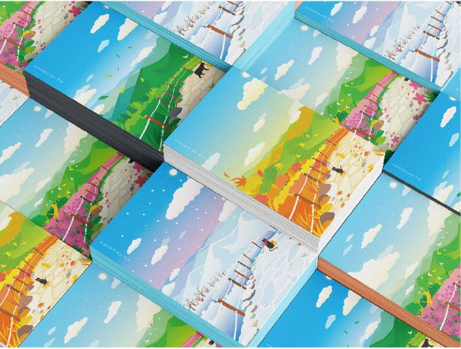 | 2,000원 | 제일 싸고 종류가 많아. 옛 전남도청 스탬프투어 엽서랑 같이 모으기 좋음 | [34] |
| **상추튀김 캐릭터 '부루' 인형** |  | 10,000원 | 광주 명물 음식 **상추튀김**을 캐릭터로 만든 거라 "광주 다녀왔다" 느낌이 확 나 | [34] |
| 부루 소주컵 2종 | 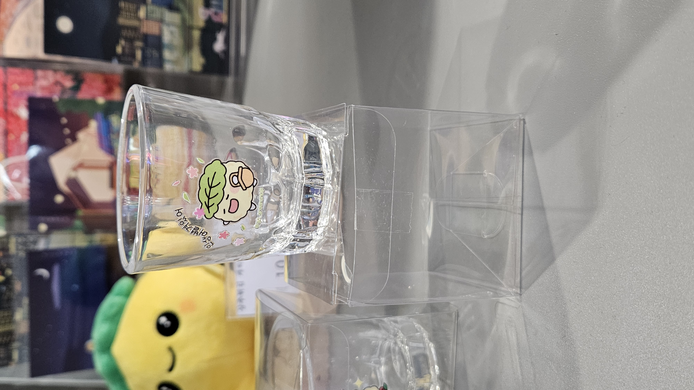 | 5,000원 | 부루 캐릭터 소주컵 | [34] |
| 명소 TEA 세트 | 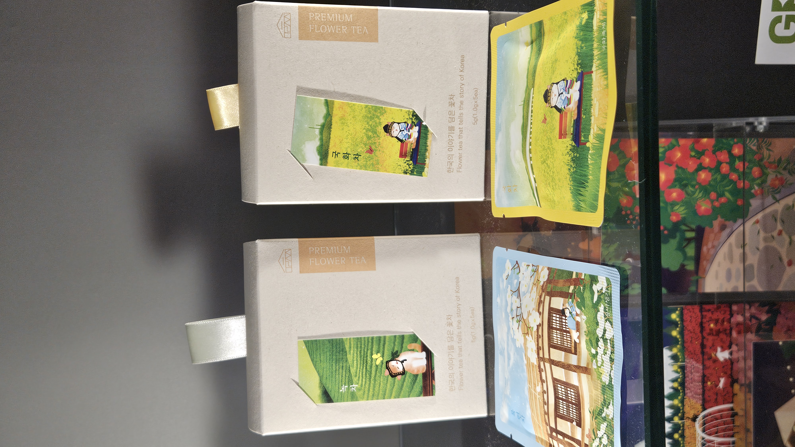 | 세트 30,000원 / 단품 7,000원 | 부모님 선물용 | [34] |

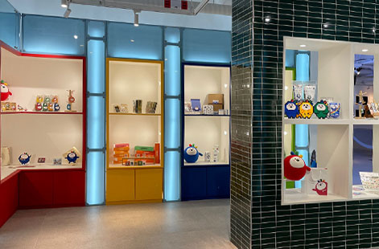
*남도관광센터 아트마켓 내부 (출처: 오매광주 [34])*

> ⚠️ "인기"라고 쓴 기준은 **온라인숍 인기 검색어와 리뷰 수**야. 실제 판매 순위는 공개된 자료가 없어서 확인 못 했어.

---

## 광고·협찬 확인
- 일정·가격·전시 정보는 **공식 사이트**(오매광주, ACC, 옛전남도청복원추진단, 들락 온라인숍)와 **언론 기사**를 기준으로 썼어
- 블로그는 공식 자료에 없는 세부 내용(10층 작품 이름, 도청 해설 소요 시간)을 보충할 때만 썼어. 각 블로그는 광고 문구가 없는 후기 글이고, 공식 블로그는 따로 표시함
- 네이버 검색 광고 영역(`ader.naver.com`)은 모두 뺐어

## 더 확인할 것
- 광주극장 쉬는 날·이번 주 상영 시간표
- 오매나하우스 운영 시간 (062-223-3631)
- 기록관 월요일 해설 시간 (062-613-8299)
- 장소 사이 실제 걷는 시간

## 출처 목록
1. 오매광주(광주 공식 관광사이트), 국립아시아문화전당 — https://tour.gwangju.go.kr/home/tour/info/sports.cs?act=view&infoId=18 (2026-11-12 확인)
2. 오매광주, 5·18민주광장 — https://tour.gwangju.go.kr/home/tour/info/history.cs?act=view&infoId=215 (2026-11-12 확인)
3. 오매광주, 전일빌딩245 — https://tour.gwangju.go.kr/home/tour/info/history.cs?act=view&infoId=1226 (2026-11-12 확인)
4. 오매광주, 5·18민주화운동기록관 — https://tour.gwangju.go.kr/home/tour/info/history.cs?act=view&infoId=1073 (2026-11-12 확인)
5. 오매광주, 금남로 — https://tour.gwangju.go.kr/home/tour/info/village/002.cs?act=view&infoId=357&category=002 (2026-11-12 확인)
6. 오매광주, 충장로 — https://tour.gwangju.go.kr/home/tour/info/village/002.cs?act=view&infoId=358&category=002 (2026-11-12 확인)
7. 오매광주, 예술의 거리 — https://tour.gwangju.go.kr/home/tour/info/village/002.cs?act=view&infoId=356&category=002 (2026-11-12 확인)
8. 오매광주, 충장로 홍콩골목 — https://tour.gwangju.go.kr/home/tour/info/village/002.cs?act=view&infoId=1447&category=002 (2026-11-12 확인)
9. 오매광주, 광주 미디어아트 플랫폼 — https://tour.gwangju.go.kr/home/tour/info/culture.cs?act=view&infoId=1050 (2026-11-12 확인)
10. 광남신문, "옛 전남도청 복원 한 달, 14만 찾은 '5월의 기록'" (2026-07-02) — http://www.gjdream.com/news/articleView.html?idxno=670630
11. 무등일보, "옛 전남도청 운영주체 선정 또 해 넘기나" (2026-11-04 무렵, 검색 결과 미리보기로 확인) — http://www.mdilbo.com/detail/c3QycN/760294
12. 남도일보, "한강의 문학적 뿌리 찾아 떠나는 남도의 길" (2026-08-21) — https://www.namdonews.com/news/articleView.html?idxno=920688
13. 전남일보, "멀티플렉스 시대 홀로 남은 극장…광주극장 국가유산 된다" (2026-10-12) — 네이버 뉴스 검색 결과 미리보기로 확인 (광주매일신문 등 같은 날 기사도 있음)
14. 한겨레, "100년 광주극장 꿈 지켜낸 '10만원의 연대'" (2026년 11월) — https://www.hani.co.kr/arti/opinion/column/1285214.html
15. 오매광주, 희경루 — https://tour.gwangju.go.kr/home/tour/info/history.cs?act=view&infoId=1428 (2026-11-12 확인)
16. 오매광주, 전라남도 도청 회의실 — https://tour.gwangju.go.kr/home/tour/info/history.cs?act=view&infoId=184 (2026-11-12 확인)
17. 오매광주, 광주YMCA — https://tour.gwangju.go.kr/home/tour/info/history.cs?act=view&infoId=228 (2026-11-12 확인)
18. 오매광주, 광주YWCA옛터 — https://tour.gwangju.go.kr/home/tour/info/history.cs?act=view&infoId=229 (2026-11-12 확인)
19. 오매광주, 궁동예술극장 — https://tour.gwangju.go.kr/home/tour/info/sports.cs?act=view&infoId=315 (2026-11-12 확인)
20. 광주매일신문, "예술적 영감 든든히 채워 '소금빛 가을'로 떠나요!" (2026년 11월 초) — http://www.kjdaily.com/article.php?aid=1793874176691414271
21. 하퍼스바자, "가을에 열리는 네 개의 비엔날레를 제대로 즐기는 방법" — 네이버 뉴스 검색 결과 미리보기로 확인 (광주비엔날레 2026.9.5~11.15)
22. 국립아시아문화전당, 개관시간/입장료 — https://www.acc.go.kr/main/contents.do?PID=060101 (2026-11-12 확인)
23. 국립아시아문화전당, 공간안내 — https://www.acc.go.kr/main/contents.do?PID=060201 (2026-11-12 확인)
24. 국립아시아문화전당, ACC 투어 — https://www.acc.go.kr/main/contents.do?PID=060107 (2026-11-12 확인)
25. 국립아시아문화전당, 〈ACT 페스티벌 2026〉 미디어파사드 — https://www.acc.go.kr/main/exhibition.do?PID=0202&action=Read&bnkey=EM_0000010183 (2026-11-12 확인)
26. 국립아시아문화전당, 인상파, 찬란한 순간들 — https://www.acc.go.kr/main/exhibition.do?PID=0202&action=Read&bnkey=EM_0000009913 (2026-11-12 확인)
27. 국립아시아문화전당, 식객: 맛의 뒤편 — https://www.acc.go.kr/main/exhibition.do?PID=0202&action=Read&bnkey=EM_0000009927 (2026-11-12 확인)
28. 국립아시아문화전당, 현재전시 목록·상세 — https://www.acc.go.kr/main/exhibition.do?PID=0202 (2026-11-12 확인)
29. 옛전남도청복원추진단 공식 누리집 — https://518history.go.kr/ (2026-11-12 확인)
30. 네이버 블로그 후기 (검색 결과 미리보기로 확인): 전남광주문화관광 공식블로그(2026-05-29, 방문자센터), Life is Journey(2026-09-14, 해설 1시간 30분)
31. 전일빌딩245 층별 정보: 나무위키 "전일빌딩245"(층별 시설), 블로그 '기미쥬.blog'(2026-05-14, 10층 작품), 「9월 추천 여행」 기사(정기 해설 시간) — 네이버 검색 결과 미리보기로 확인
32. 5·18민주화운동기록관, 전시실 소개 — https://www.518archives.go.kr (검색 결과로 확인) / 뉴스컬처(2024-08-27, 층별 주제)
33. 오매광주, 5·18민주화운동기록관·광주 미디어아트 플랫폼·5·18민주광장 등 — https://tour.gwangju.go.kr/home/tour/info/history.cs?act=view&infoId=1073 외 (2026-11-12 확인)
34. 오매광주, 광주관광기념품 — https://tour.gwangju.go.kr/home/board/B0046.cs?m=313 (2026-11-12 확인, 사진 출처)
35. 광주타임즈, "100년을 향하는 '광주극장'…개관 91주년 영화제" (2026-10-11) — 네이버 검색 결과 미리보기로 확인 / 경향신문, "90년 전통 광주극장에는 '손간판' 그리는 화백이 있다" (2025-10-29)
36. 국립아시아문화전당, ACC 문화상품점 — https://www.acc.go.kr/main/contents.do?PID=060106 (2026-11-12 확인)
37. ACC 문화상품점 들락 온라인숍 — https://www.accdlacshop.co.kr/ (2026-11-12 확인, 사진·가격·인기 검색어·리뷰 수 출처)
